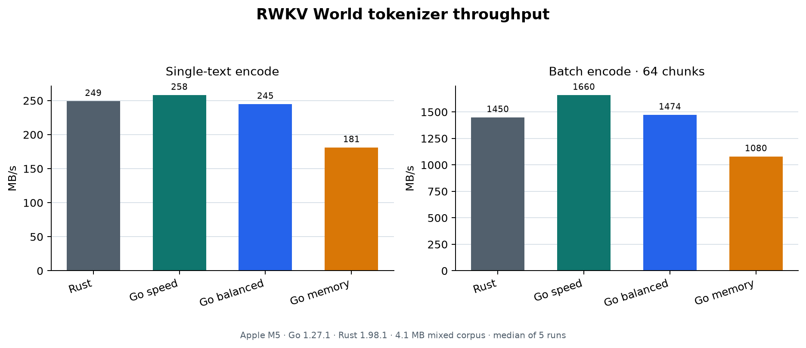

# rwkv-tokenizer-go

A pure-Go implementation of the RWKV **World** tokenizer used by RWKV v5/v6
models, ported from the reference Rust implementation
[cahya-wirawan/rwkv-tokenizer](https://github.com/cahya-wirawan/rwkv-tokenizer).
It produces **byte-for-byte identical token ids** to the Rust tokenizer
(verified against its output on a 4 MB mixed-language corpus and its own test
vectors), with measured throughput on the 4.1 MB mixed corpus at ~104% of the Rust
build for single-thread encoding and ~115% for parallel batch encoding.

```go
tok, _ := rwkv.New() // vocab embedded, no external files needed
ids := tok.Encode("Today is a beautiful day. 今天是美好的一天。")
// [33520 4600 332 59219 21509 47 33 10381 11639 13091 15597 11685 14734 10250 11639 10080]
text, _ := tok.Decode(ids)
```

## Features

- **Zero dependencies**, pure Go. The standard vocab (`rwkv_vocab_v20230424.txt`,
  65,529 tokens) is embedded via `go:embed`; custom vocab files load through
  `NewFromFile` / `NewFromReader`.
- **Faithful algorithm**: greedy longest-prefix match over a byte trie, exactly
  like the reference; no BPE, no pretokenization. Byte tokens (`b'\xNN'`)
  guarantee every input byte is encodable, so raw and even invalid-UTF-8 input
  round-trips through `EncodeBytes` / `DecodeBytes`.
- **Fast**: flat, GC-invisible trie (int32 indices, 16-byte nodes, direct
  256-entry child tables for branching nodes), allocation-light hot path,
  `EncodeBatch` parallelizes across all cores.
- **Concurrent use**: a `Tokenizer` is read-only after construction and safe
  for use from multiple goroutines.

## Presets

Choose the memory/throughput tradeoff when creating a tokenizer:

```go
fast, err := rwkv.New() // defaults to PresetSpeed
balanced, err := rwkv.New(rwkv.WithPreset(rwkv.PresetBalanced))
small, err := rwkv.New(rwkv.WithPreset(rwkv.PresetMemory))

// The same option works with custom vocabularies.
tok, err := rwkv.NewFromFile("vocab.txt", rwkv.WithPreset(rwkv.PresetMemory))
fmt.Println(tok.Preset()) // memory
```

| Preset | CLI value | Standard-vocab trie memory | Layout |
|---|---|---:|---|
| `PresetSpeed` (default) | `speed` | 16.23 MiB | Direct tables for every branching node |
| `PresetBalanced` | `balanced` | 3.34 MiB | Direct tables for large branches, short edge lists elsewhere |
| `PresetMemory` | `memory` | 2.31 MiB | Sorted edge lists; binary search for large branches |

Memory figures include retained trie storage and exclude token storage, temporary
construction allocations, and allocator overhead. All presets retain the two-byte
prefix shortcut. They produce identical token IDs, support the same custom
vocabularies, and remain safe for concurrent use. Presets affect encoding speed
and trie memory; they do not change the decoding algorithm or the vocabulary.
The choice is fixed at construction time; reuse the tokenizer across calls.
Unknown presets return an error. See [preset measurements](bench/PRESETS.md).

## API

```go
func New(opts ...Option) (*Tokenizer, error)                       // embedded standard vocab
func NewFromFile(path string, opts ...Option) (*Tokenizer, error)    // custom vocab file
func NewFromReader(r io.Reader, opts ...Option) (*Tokenizer, error)
func NewFromBytes(data []byte, opts ...Option) (*Tokenizer, error)

func (t *Tokenizer) Encode(text string) []int32
func (t *Tokenizer) AppendEncode(dst []int32, text string) []int32  // reuse buffer
func (t *Tokenizer) EncodeBytes(data []byte) []int32                // raw bytes, no UTF-8 required
func (t *Tokenizer) AppendEncodeBytes(dst []int32, data []byte) []int32
func (t *Tokenizer) EncodeBatch(texts []string) [][]int32           // parallel
func (t *Tokenizer) EncodeBatchBytes(datas [][]byte) [][]int32

func (t *Tokenizer) Decode(ids []int32) (string, error)             // validates UTF-8
func (t *Tokenizer) DecodeBytes(ids []int32) ([]byte, error)
func (t *Tokenizer) VocabSize() int
func (t *Tokenizer) Preset() Preset
func WithPreset(preset Preset) Option
```

Behavioral notes, matching the reference implementation:

- Token ids fit in `uint16` (World vocab ids are 1..65529); id 0 decodes to a
  NUL byte placeholder.
- `Decode` fails on ids outside the vocab or on byte sequences that are not
  valid UTF-8; `DecodeBytes` skips the UTF-8 check.
- The greedy matcher stops early only if a byte starts no token at all, which
  cannot happen with the standard vocab (all 256 byte values have a token).

## CLI

```
go install github.com/No-22-Github/rwkv-tokenizer-go/cmd/rwkv-tokenizer@latest

echo "你好，世界" | rwkv-tokenizer encode                 # print token ids
rwkv-tokenizer decode <<< "10381 11639 13091 ..."        # ids -> text
rwkv-tokenizer bench -in corpus.txt -iters 20            # default speed preset
rwkv-tokenizer bench -preset balanced -in corpus.txt -iters 20
rwkv-tokenizer encode -preset memory -in corpus.txt      # lowest trie memory
rwkv-tokenizer bench -in corpus.txt -iters 20 -batch 64  # parallel throughput
rwkv-tokenizer dump -in corpus.txt -out ids.bin          # binary ids (u32 count + u32 LE)
```

## Benchmarks

The reproducible run used Apple M5, Go 1.27.1 and Rust 1.98.1, with the pinned
reference at `63b21e89`. The corpus is 4,103,643 bytes and 1,348,484 tokens;
results are the median of five interleaved 100-iteration runs after three
warmups. Batch mode uses 64 newline-aligned chunks and 10 workers.



The chart compares the pinned Rust reference with all three Go presets. The
Rust implementation is the upstream `rwkv-tokenizer` API; Go uses the same
vocabulary and verifies complete token dumps before timing. The current Go
column uses `PresetSpeed`. The previous Go column is retained as historical
context for the optimization work.

| mode | Rust reference | Previous Go | Current Go | Go/Rust |
|---|---:|---:|---:|---:|
| encode, single thread | 249.2 MB/s | 230.8 MB/s | 258.2 MB/s | 103.6% |
| encode-batch, 64 chunks | 1449.7 MB/s | 1344.9 MB/s | 1660.2 MB/s | 114.5% |

The speed preset uses direct lookup tables for all branching nodes and carries
the loaded node between loop iterations. It retains the two-byte prefix shortcut.
Retained trie storage increases from about 3.91 MiB to 16.23 MiB per tokenizer
(excluding vocabulary token storage). These are local warm-throughput measurements,
not universal language/runtime ratios. See
[benchmark details and reproduction](bench/ROUND2.md) for memory usage,
smaller corpora and API allocation differences.

## Correctness

- `TestEncodeBeautifulDay` checks the exact ids from the reference's test
  suite.
- `TestGoldenEdgeCases` compares against ids dumped from the Rust tokenizer
  over ~40 edge-case inputs (newline/space/digit runs, quotes, emoji ZWJ,
  noncharacters, CJK, box drawing, CRLF, …) — see `bench/generate.py`.
- The full 4.1 MB corpus was verified byte-identical against the Rust dump.
- Property tests round-trip random bytes (including invalid UTF-8) and a fuzz
  target (`FuzzEncodeDecodeBytes`) enforces encode→decode == identity.

## Vocab format

Each line is `<id> (b?)'<python-escaped token>' <byte length>`; string tokens
use Python repr escapes (`\xHH`, `\uHHHH`, `\UHHHHHHHH`, `\n`, `\t`, `\r`,
`\\`, `\'`, `\"`), byte tokens are `\xHH` sequences of raw bytes. Files with
this format load via `NewFromFile`.

## Attribution

- Algorithm ported from [cahya-wirawan/rwkv-tokenizer](https://github.com/cahya-wirawan/rwkv-tokenizer) (Apache-2.0).
- Vocab file `rwkv_vocab_v20230424.txt` from [BlinkDL/RWKV-LM](https://github.com/BlinkDL/RWKV-LM) (Apache-2.0).

Licensed under the Apache License, Version 2.0.
